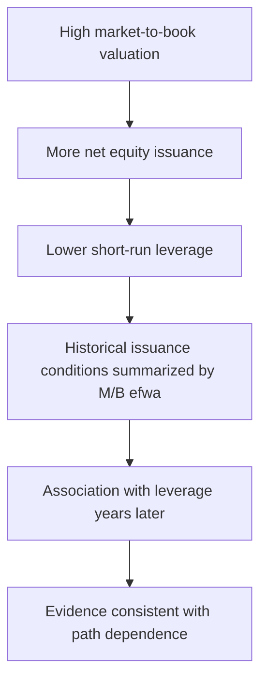

# Empirical findings: Short-run issuance and long-run persistence

**Attribution:** The findings below are from **Baker and Wurgler's research**, as summarized in the course group's slides. This repository contains no new regressions or independent numerical replication.

## 1. High valuations and short-run leverage changes

The presentation describes regressions of **changes in leverage** on lagged market-to-book ratios. It reports a negative relationship: when market-to-book is higher, subsequent leverage tends to fall.

The decomposition suggests the relationship is driven mainly by **net equity issuance** rather than retained earnings or a simple substitution away from debt.

The slides give a concrete illustration for **IPO+3**:

> A one-standard-deviation increase in market-to-book is associated with a **1.14 percentage-point decrease in leverage**.

This is a reported regression association, not a statement that every firm experiences the same leverage change.

*Presentation: slides 12–13.*

## 2. Which financing channel drives the result?

| Channel | Presentation's characterization | Implication |
| --- | --- | --- |
| Net equity issuance | Strong increase when market-to-book is high | Consistent with firms raising equity during favorable valuations |
| Retained earnings | Weak explanatory role in this decomposition | Not the main channel highlighted by the paper |
| Debt issuance | Not driving the reported relationship | Lower leverage is not explained primarily by debt substitution |

The key contribution is connecting valuations to a **specific financing decision**, rather than treating changes in leverage as purely mechanical balance-sheet fluctuations.

*Presentation: slide 13.*

## 3. Historical valuations explain current leverage

The paper's external-finance-weighted average market-to-book measure is reported to have a **large, negative and statistically significant** relationship with leverage.

The group emphasizes that the historical measure is reported to be more informative in the presented specifications than current market-to-book and several standard firm characteristics. The relationship becomes important when considering firms at different ages after IPO.

This is the main bridge from short-run issuance behavior to the paper's claim about **path dependence**.

*Presentation: slides 14–15.*

## 4. How long do the effects last?

The presentation's persistence slide reports:

| Leverage measure | Reported persistence |
| --- | --- |
| **Book leverage** | **73%** of the historical market-timing effect remains after **10 years** |
| **Market leverage** | Approximately **100%** persistent in the presented analysis |

The implication offered is that firms do not rapidly undo the leverage effects associated with their historical equity-market timing.

These percentages are tied to the paper's empirical specification and should not be interpreted as universal persistence rates or a direct forecast for any particular firm.

*Presentation: slide 16.*

## 5. Changes since IPO

The group also discusses regressions of **cumulative changes in leverage since the pre-IPO period** on the historical market-to-book measure.

The slides interpret the continued relationship as evidence that the result is not solely explained by stable differences between firms. That is a meaningful robustness argument, although the presentation's phrase that this “proves” the absence of omitted fixed traits is stronger than the evidence alone can establish.

*Presentation: slide 17.*

## 6. Robustness checks discussed

The presentation reports that the paper examines:

- **Book and market leverage**
- **IPO cohorts and broader Compustat observations**
- **Industry and firm fixed effects**
- **Tobit specifications**
- **Specifications including retained earnings**

The slides describe the main relationship as robust across these checks. The original paper should be consulted for coefficient sizes, confidence intervals and exact specification differences.

*Presentation: slide 18.*

## 7. What the results mean for capital-structure theory

The paper's evidence supports a view in which **capital structure is influenced by a sequence of historical financing opportunities**. It challenges simple predictions that leverage deviations created by equity issuance will be quickly reversed.

It does **not** necessarily mean that target leverage, financial distress, tax incentives or information asymmetry are irrelevant. The empirical question is how much explanatory power financing history adds relative to those factors.

## Summary of the empirical narrative

*Conceptual summary of reported relationships, not an independently estimated causal model.*

[Return to README](README.md)
